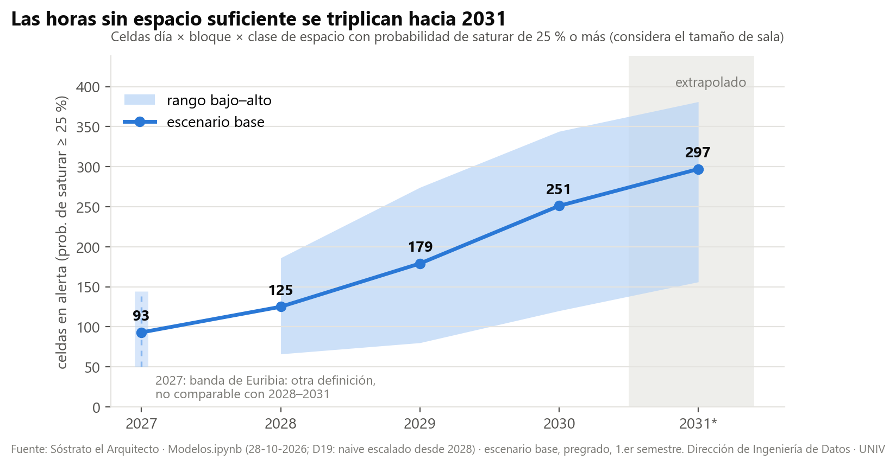
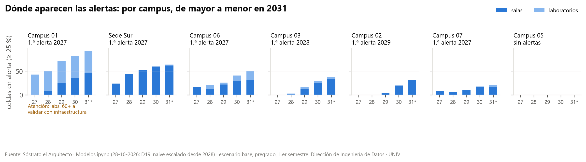
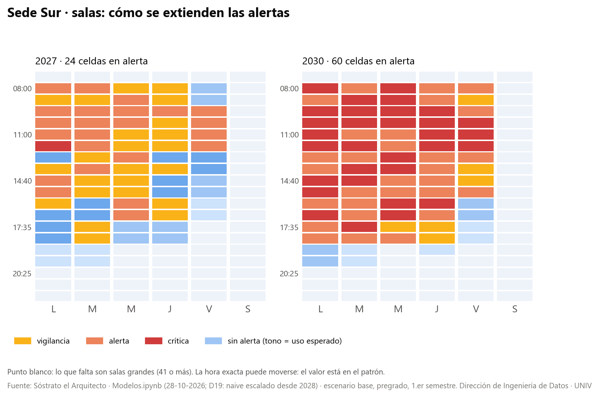
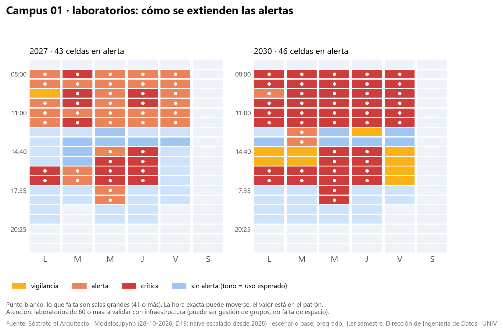
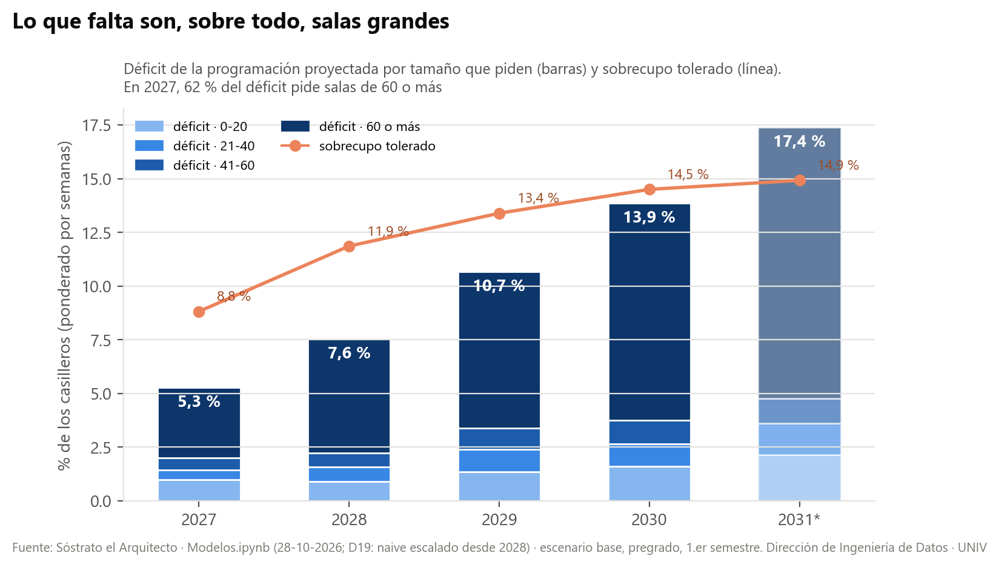

# Sóstrato el Arquitecto · Dónde y cuándo faltarán salas, 2027–2031

**Informe ejecutivo** · Dirección de Ingeniería de Datos · 28 de octubre de 2026

## 1. El mensaje en una página

La matrícula de pregrado sigue creciendo y los espacios físicos no crecen al mismo ritmo. Si se mantienen la planta física actual y la forma de programar de hoy, **las horas en que no alcanzan las salas o los laboratorios se triplican entre 2027 y 2031**.

| Indicador (pregrado, 1.er semestre, escenario base) | 2027 | 2029 | 2031 |
|---|---|---|---|
| Horas-espacio en alerta (≥ 25 % de probabilidad de que no alcancen los espacios) | **93** | 179 | **297** |
| Horas-espacio en alerta crítica (≥ 50 %) | 17 | 58 | 136 |
| Clases sin sala disponible en la programación proyectada | **5,3 %** | 10,7 % | **17,4 %** |

**Tres alertas principales**
1. **Sede Norte, Campus 01 (C01), es el primer foco.** En 2027 ya faltan laboratorios grandes, y desde 2028 empiezan a faltar también salas. En 2031 concentra 93 horas en alerta, casi un tercio del total.
2. **Sede Sur (C04) y Campus 06 (C06) se quedan cortos de salas de cualquier tamaño.** En C04 las horas en alerta pasan de 24 en 2027 a 60 en 2030: lo que hoy pasa en las mañanas se extiende a la tarde.
3. **Lo que más falta son salas grandes.** Siete de cada diez clases que se quedan sin sala piden una de 60 o más asientos.

**Qué se recomienda decidir**
- Validar con infraestructura la capacidad registrada de los espacios de C01, C04 y C06 antes de comprometer inversión.
- Priorizar el estudio de salas grandes, de 60 o más asientos, en los campus que aparecen primero.
- Definir cada cuánto se actualiza esta proyección. Se recomienda una vez al semestre, con la programación cerrada.

## 2. Qué se proyectó y cómo leerlo

Se proyectó, para cada campus, día, bloque horario y tipo de espacio (sala o laboratorio), **cuántos espacios ocupará la programación académica** de 2027 a 2031. Esa demanda se comparó con los espacios que existen hoy en la planta física. Se consideró el tamaño: una clase de 80 estudiantes no cabe en una sala de 20.

- **Hora-espacio en alerta:** un bloque de un día, en un campus y un tipo de espacio, donde hay **al menos un 25 % de probabilidad** de que no alcancen los espacios del tamaño necesario. Se vigila desde el 10 % y se considera crítica desde el 50 %.
- **Clases sin sala:** en la programación proyectada clase por clase, el porcentaje de horas de clase a las que no se les encuentra una sala libre del tamaño adecuado.
- **Escenarios:** el **base** es la proyección central. El **bajo** y el **alto** muestran qué pasa si la matrícula crece menos o más de lo esperado.
- **Horizonte:** 2027 a 2030 se contrastó con lo que ocurrió en años anteriores. **2031 es una extrapolación** y se lee como tendencia.

## 3. Cuántas alertas y cuándo

| Año | Bajo | **Base** | Alto |
|---|---|---|---|
| 2027 | 50 | **93** | 144 |
| 2028 | 66 | **125** | 186 |
| 2029 | 80 | **179** | 274 |
| 2030 | 120 | **251** | 344 |
| 2031* | 156 | **297** | 381 |

\* 2031 extrapolado.

- Hasta en el escenario bajo, las alertas se triplican entre 2027 y 2031.
- El rango de 2027 se construye de otra manera que el de 2028–2031, así que no deben compararse entre sí.

## 4. Dónde: por campus y tipo de espacio

| Campus | Primera alerta | 2031 | Qué falta |
|---|---|---|---|
| Sede Norte, Campus 01 (C01) | 2027 | 93 | Laboratorios grandes desde 2027; salas desde 2028 |
| Sede Sur (C04) | 2027 | 64 | Salas de cualquier tamaño |
| Sede Centro, Campus 06 (C06) | 2027 | 50 | Salas y, desde 2028, laboratorios |
| Sede Austral, Campus 03 (C03) | 2028 | 37 | Salas, sobre todo desde 2029 |
| Sede Centro, Campus 02 (C02) | 2029 | 32 | Salas |
| Sede Norte, Campus 07 (C07) | 2027 | 21 | Salas medianas y grandes |
| Sede Centro, Campus 05 (C05) | — | 0 | Sin alerta en el período |

En Sede Sur la alerta se extiende de las mañanas a la tarde:

En los laboratorios de Campus 01 la alerta aparece por el tamaño: en 2027, 27 de las 43 horas en alerta piden laboratorios de 60 o más.

> **A validar con infraestructura:** si esos laboratorios se usan en la práctica dividiendo el curso en grupos, la alerta es de gestión de horarios y no de falta de espacio.

## 5. Qué tamaño de sala falta

- **Clases sin sala:** pasan de 5,3 % en 2027 a 17,4 % en 2031. Entre el 62 % y el 73 % de ellas piden salas de 60 o más asientos.
- **Sobrecupo:** sube de 8,8 % a 14,9 %. Son clases que caben dentro de la holgura con que hoy se usan los espacios, pero que superan la capacidad nominal de la sala. No es una falta de espacio, pero sí una señal de presión.

## 6. Qué tan firme es la señal

- **El crecimiento y el riesgo son firmes; la hora exacta no.** El modelo se probó proyectando años pasados y comparando con lo que ocurrió. Acierta la magnitud y el campus donde aparece la presión, pero la hora exacta de una alerta puede moverse un bloque o un día.
- **El margen de error está medido.** Los rangos de cada hora-espacio se calibraron con los errores observados en años anteriores. En la práctica contienen el valor real tres de cada cuatro veces, algo menos que el 80 % buscado. Los rangos se ensanchan con los años.
- **Los años lejanos tienen menos respaldo.** 2028–2030 se validaron con pocos años de historia, y 2031 es una extrapolación.
- **Supuestos que pueden cambiar el resultado:**
  - la planta física se mantiene como está hoy;
  - se programa como hoy, con los mismos tamaños de sección y horarios;
  - la matrícula sigue la proyección institucional vigente.

  Si alguno cambia, por ejemplo con espacios nuevos, otros horarios o cambios de oferta, la proyección debe actualizarse.

## 7. Decisiones y próximos pasos sugeridos

| # | Paso | Para qué |
|---|---|---|
| 1 | Validar con infraestructura la capacidad registrada de los espacios, empezando por C01, C04 y C06 | La alerta depende de esa capacidad |
| 2 | Revisar si los laboratorios grandes de C01 se usan por grupos | Separar falta de espacio de gestión de horarios |
| 3 | Estudiar opciones para salas de 60 o más en los campus que aparecen primero: espacios nuevos, reconversión o redistribución de horarios | Es lo que más falta |
| 4 | Actualizar la proyección cada semestre con la programación cerrada | Que las alertas sigan vigentes |
| 5 | Incorporar las decisiones de infraestructura (espacios nuevos o cerrados) como escenarios | Medir el efecto antes de decidir |

## 8. Cómo usar la simulación

La simulación interactiva muestra, año a año, **dónde surgen las alertas**. Está en [DEMO_SOSTRATO.html](maquetas_visualizacion/DEMO_SOSTRATO.html) y se abre con doble clic; la vista 3D necesita conexión a internet.

- **Reproductor 2027–2031:** avanza los años y todas las vistas cambian juntas.
- **Filtros:** campus, semestre, escenario (base por defecto) y tamaño de sala.
- **Vistas:**
  - curva de alertas por año;
  - mapa semanal con semáforo (vigilancia, alerta y crítica);
  - programación proyectada, que muestra en naranja las clases en sobrecupo y en rojo las que quedan sin sala;
  - vista 3D «dónde no cabe» de cada campus.

---

> **Dirección de Ingeniería de Datos — Universidad Ficticia**
> Responsable: Diego Evans Pérez Paz
