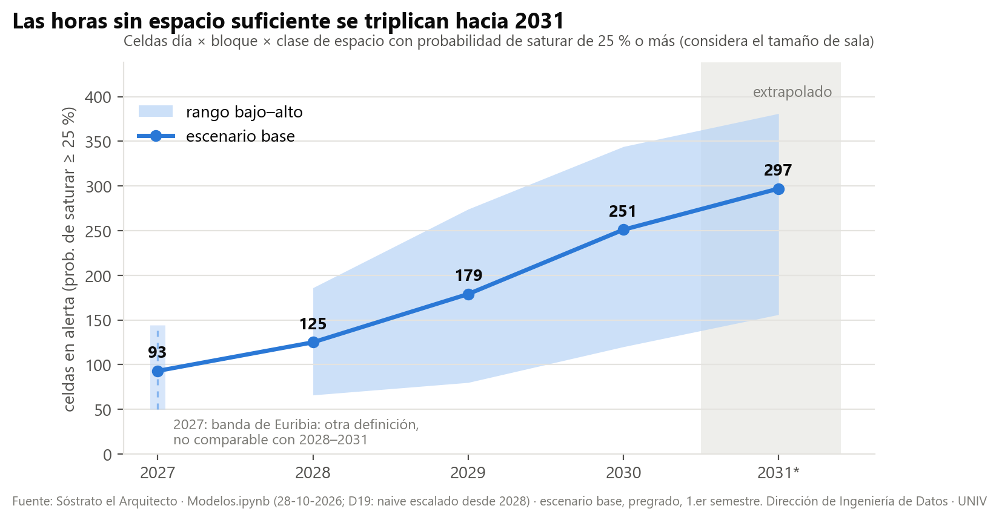
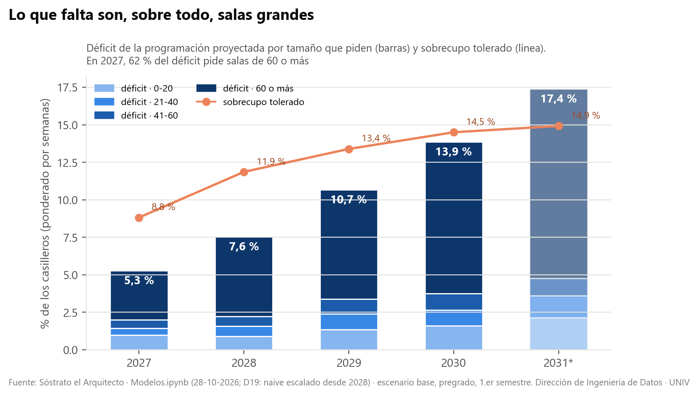
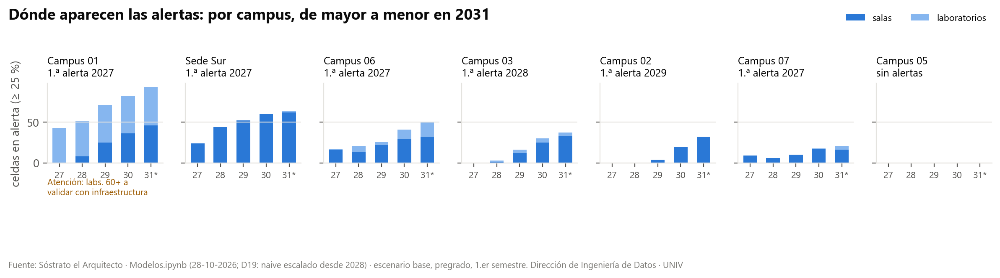

# Sóstrato el Arquitecto · Modelo de alertas de ocupación: resultados 2027–2031

**Informe técnico de resultados** · Dirección de Ingeniería de Datos · 28 de octubre de 2026

Este informe presenta los resultados del modelo, cómo se obtuvieron y qué tan confiables son. El detalle de cada decisión de diseño (D14 a D19) está en `DIAGNOSTICO_EMPALME.md` y en el roadmap del proyecto.

## 1. Qué resuelve y alcance

**Pregunta:** en qué campus, día, bloque y tipo de espacio la programación académica proyectada no cabrá en la planta física, de 2027 a 2031, y con qué probabilidad.

**Universo**
- Pregrado (UG, sufijos 10 y 20) y advance (AV, sufijos 05, 15 y 25).
- Siete campus con planta física: C01, C07, C04, C06, C02, C05 y C03.
- Solo espacios físicos: salas y laboratorios. Quedan fuera los espacios externos, los «espacio UNIV» y las salas virtuales.
- **Las cifras del informe son de pregrado, sufijo 10 (1.er semestre), escenario base**, salvo que se indique otra cosa.

**Glosario**

| Término | Significado |
|---|---|
| Celda | Campus × día × bloque × clase (sala o laboratorio). Hay 21 bloques por día, el 0 es «antes de las 08:00» |
| Ocupación | Espacios usados en la celda, ponderados por las semanas de cada sección (`PESO_SEMANAS`) |
| Rango | Tamaño de sala que necesita una sección: 0-20, 21-40, 41-60 o 60 o más |
| Alerta anidada | Para cada rango r, la demanda que necesita r o más contra los espacios de r o más |
| `PROB_SATURA_TAMANO` | Probabilidad de que la demanda supere a la oferta en el rango más exigido de la celda |
| Semáforo | Vigilancia ≥ 10 %, **alerta ≥ 25 %** (la cifra que se informa) y crítica ≥ 50 % |
| H | Años entre la base (2026) y el objetivo: 2027 = H+1 … 2031 = H+5 |
| MASE | WAPE del modelo ÷ WAPE del naive; bajo 1 le gana al naive |

## 2. Arquitectura y linaje

| Paso | Notebook (.ipynb) | Qué hace | Salidas principales en `BBDD/` |
|---|---|---|---|
| 1 | `PIPELINES` | Programación histórica, planta física, perfiles horarios y mapa real | `PROG_HIST_NRC`, `OFERTA_ESPACIOS`, `PERFIL_HORARIO` |
| 2 | `VALIDACION_WALKFORWARD` | Banco de validación: 10 orígenes a 1 año, pseudo-backtest a 1–4 años, banda conformal y rango | `VALIDACION_*`, `BANDA_*`, `ARIADNA_ERROR_HORIZONTE` |
| 3 | `Modelos` | Lee los parámetros del banco y proyecta 2027–2031 | `MAPA_PROYECTADO`, `OCUPACION_Y_DEFICIT`, `OCUPACION_POR_RANGO`, `PROGRAMACION_SINTETICA`, `MODELO_METADATOS.json` |
| 4 | `scripts_fase1/` | Datos de la simulación y figuras | `DEMO_SOSTRATO.html`, `figuras_alertas/` |

**Insumos externos**
- **Euribia:** inscripción por asignatura para 2027, y su banda.
- **Ariadna:** matrícula por carrera × sede hasta 2031, con sus filas reales desde 2010. Se usa tal cual, sin modificarla.
- **Planta física:** capacidad y estado de cada espacio.

El orden de ejecución es fijo: primero el banco y después Modelos, porque Modelos lee del banco el modelo adoptado, los pesos, la banda y el k_h.

## 3. El modelo

**Volumen.** Inscritos por campus × asignatura × componente.
- **2027:** variante adoptada en el banco. En UG es **TEN**, la tendencia por campus; en AV es **EUR**, el pronóstico de Euribia.
- **2028–2031:** se encadena el crecimiento de la matrícula de Ariadna.
- En UG, sufijo 10: 345.663 inscritos en 2027 → 364.946 → 385.183 → 406.469 → **428.813 en 2031** (+24 %). La base de 2026 es de 329.627.

**Mapa de ocupación**

| Período | Modelo | Fórmula | w (UG / AV) |
|---|---|---|---|
| 2027 | **C1** | w · naive + (1 − w) · G1b | 0,8 / 0,0 |
| 2028–2031 | **C1E** (D19) | w · naive escalado + (1 − w) · G1b | 1,0 / 1,0 |

- **Naive:** el mapa real de 2026 del mismo sufijo.
- **Naive escalado:** el naive de cada campus × clase multiplicado por el crecimiento de salas que implica G1b. En UG, sufijo 10, la mediana del factor es 1,07 en 2028, 1,12 en 2029, 1,17 en 2030 y 1,22 en 2031.
- **G1b:** remuestreo de las secciones físicas reales de 2026 por estrato (campus × unidad × clase × componente) hasta el volumen proyectado. El número de salas crece como razón^β, con elasticidad β = 0,82 en el sufijo 10 y 0,80 en el 20.

**Programación sintética explícita**
- El número de secciones sale del **estándar real**: el percentil de tamaño de sección que reproduce lo programado en 2026, por sede × componente.
- En UG, sufijo 10, son 9.885 secciones en 2027 y **12.263 en 2031**.
- Cada sección se ubica en una sala libre equivalente. Lo que no cabe es déficit.

## 4. Rango de capacidad y alerta

1. **Tolerancia por clase:** el percentil 90 de inscritos ÷ capacidad por sala-bloque en 2026, con piso 1. Queda en SALA 1,00 y LABORATORIO 1,33 (sufijo 10) y 1,32 (sufijo 20).
2. **Capacidad que necesita una sección:** inscritos proyectados ÷ el mayor entre la tolerancia de su clase y el sobrecupo que ya tenía en su sala. Los inscritos proyectados son los de 2026 × razón del estrato^(1 − β).
3. **Oferta efectiva por rango**, desde 21-40: el mayor entre el inventario activo y lo que 2026 ya usa. Con esto, el período base no queda en alerta.
4. **Regla anidada:** la demanda de r o más contra los espacios de r o más. `PROB_SATURA_TAMANO` es el máximo entre rangos y `RANGO_CRITICO` es el rango donde se alcanza.
5. **Programación:**
   - la sección se queda en su sala si cabe;
   - si no cabe, busca la sala libre más chica que sirva, primero en su edificio y después en su campus;
   - `SOBRECUPO` marca las secciones que caben por tolerancia pero superan la capacidad nominal.

## 5. Validación y desempeño

**Banco a 1 año, pregrado: MASE en la celda contra el naive, orígenes que deciden**

| Modelo | 202410 | 202420 | 202520 | 202610 | 202620 |
|---|---|---|---|---|---|
| C1 con volumen real (techo) | 1,000 | 0,992 | 0,987 | 0,959 | 0,944 |
| **C1-TEN (adoptado en 2027)** | 1,000 | 0,971 | 1,152 | 0,996 | 0,996 |
| C1-EUR | 1,000 | 1,016 | 1,047 | 1,000 | 1,000 |
| C1E-TEN | 0,942 | 0,946 | 1,232 | 1,046 | 1,124 |

- **Regla de adopción:** gana al naive en la mayoría de los orígenes que deciden, tanto en celda como en campus × día × bloque.
- C1-TEN la cumple, pero con ventaja marginal. Incluso con el volumen real, el modelo gana como mucho un 6 %.
- **El valor está en el crecimiento y el riesgo, no en la ubicación fina.**

**Pseudo-backtest de largo plazo** (bases 2022–2024 con la matrícula real de Ariadna, pregrado, celda)

| | H+1 | H+2 | H+3 | H+4 |
|---|---|---|---|---|
| MASE C1 | 1,009 | 1,001 | 0,995 | 0,993 |
| **MASE C1E** | 1,053 | **1,012** | **0,959** | **0,962** |
| Sesgo C1 | −0,8 % | −2,5 % | −5,0 % | −7,6 % |
| **Sesgo C1E** | +3,0 % | +2,7 % | −0,2 % | **−2,7 %** |

- C1E corrige el sesgo de C1, que se quedaba corto en el crecimiento, y mejora el MASE desde H+3.
- **Aviso:** en H+2 (2028) C1E empeora el MASE en 0,011, dentro del ruido de ±0,02.
- H+4 tiene solo 2 pares de pregrado, ambos con objetivo 2026.

**Rango, validación informativa (banco §8)**
- El MASE por rango contra el naive queda entre 0,98 y 1,03.
- El reparto entre rangos sí acierta. En 202620, proyectado contra real:

  | | 0-20 | 21-40 | 41-60 | 60 o más |
  |---|---|---|---|---|
  | Proyectado | 40 % | 31 % | 13 % | 16 % |
  | Real | 40 % | 30 % | 16 % | 14 % |

**Evolución de las decisiones**

| Decisión | Qué cambió |
|---|---|
| D14 | Se adopta C1 (naive + G1b) |
| D15 | Volumen proyectado: TEN en UG, EUR en AV |
| D16 | Banda P10–P90 conformal |
| D17 | Largo plazo con k_h y escenarios de Ariadna ensanchados según su propio backtest |
| D18 | Rango de capacidad con alerta anidada |
| D19 | Naive escalado (C1E) en 2028–2031 |

## 6. Incertidumbre

- **Banda conformal a 1 año.** Es el residuo e = (real − punto) / √(punto + 1), estratificado por nivel × clase × tramo de ocupación. Con C1-TEN, en pregrado cubre en promedio un **75 %** (de 63 % a 81 % según el origen), bajo el 80 % buscado. Subcubre en 202420 y 202520. Con C1E-TEN, la banda de 2028–2031, cubre un 76 %.
- **Largo plazo.** Los cuantiles se ensanchan alrededor de la mediana con k_h de C1E. En UG: 1,31 (2028), 1,44 (2029), 1,72 (2030) y 1,82 (2031, extrapolado).
- **Escenarios bajo y alto.**
  - **2027:** suma los cuantiles P10/P90 de Euribia por tipo de curso, como si todos subieran o bajaran a la vez.
  - **2028–2031:** son los escenarios de Ariadna, ensanchados según su propio backtest (UG ×1,13 / 1,34 / 1,76). Ariadna tiende a subestimar el crecimiento.
  - Los dos rangos **no son comparables**.
- **Las bandas no se suman entre celdas:** los totales cuentan celdas por escenario.

## 7. Anti-leakage

- Cada origen del banco usa solo la información disponible antes del período objetivo: secciones, volumen, β, tolerancia y calibración de la banda.
- La banda de un origen se calibra con los orígenes anteriores del mismo nivel. Los primeros usan el naive T−100 / T−200.
- En el pseudo-backtest, la matrícula «real» de Ariadna sustituye a un pronóstico que no se guardó. Por eso mide el mejor caso del volumen y no el error de Ariadna, que se agrega aparte con su propio backtest.

## 8. Cálculo demostrado: C04, salas, martes bloque 4 (10:10)

| | 2027 (C1) | 2030 (C1E) |
|---|---|---|
| Factor de escala del naive | 1,000 | 1,221 |
| w | 0,8 | 1,0 |
| Ocupación puntual | 36,6 | 44,0 |
| Banda P10 / P50 / P90 | 29,0 / 37,4 / 47,3 | 28,6 / 42,5 / 64,8 |
| Salas en la celda | 39 | 39 |
| `PROB_SATURA` (rango 0-20, la celda completa) | 0,40 | 0,74 |

Demanda acumulada por rango en 2030 (P50) contra los espacios de ese rango o más:

| Rango desde | Demanda P50 | Espacios | Probabilidad |
|---|---|---|---|
| 0-20 | 48,8 | 39 | **0,74** |
| 21-40 | 42,0 | 37 | 0,60 |
| 41-60 | 25,4 | 28 | 0,30 |
| 60 o más | 9,5 | 21 | 0,00 |

**Lectura**
- En 2030 la celda está en alerta crítica, con `PROB_SATURA_TAMANO` = 0,74 y `RANGO_CRITICO` 0-20: faltan salas de cualquier tamaño.
- En 2027 estaba en alerta (0,40).
- Las salas de 41-60 también entran en alerta en 2030 (0,30), cuando en 2027 estaban en 0,00.

## 9. Lectura de resultados

| | 2027 | 2028 | 2029 | 2030 | 2031* |
|---|---|---|---|---|---|
| Celdas ≥ 25 %, con tamaño | 93 | 125 | 179 | 251 | 297 |
| Celdas ≥ 25 %, sin tamaño | 48 | 79 | 127 | 198 | 239 |
| Celdas ≥ 10 % | 181 | 297 | 366 | 427 | 466 |
| Celdas ≥ 50 % | 17 | 33 | 58 | 94 | 136 |
| Déficit de la programación | 5,3 % | 7,6 % | 10,7 % | 13,9 % | 17,4 % |
| Sobrecupo tolerado | 8,8 % | 11,9 % | 13,4 % | 14,5 % | 14,9 % |
| Ocupación total del mapa (centro) | 26.419 | 28.183 | 29.459 | 30.790 | 32.172 |

\* 2031 extrapolado. El déficit y el sobrecupo están ponderados por `PESO_SEMANAS`. Las vistas de la simulación van de lunes a sábado, así que en 2031 muestran 465 celdas ≥ 10 % en vez de 466.

**Por qué el mapa y la programación no coinciden por campus**

| Campus | Casilleros sin sala, 2027 → 2031 | Celdas en alerta, 2027 → 2031 |
|---|---|---|
| C02 | 653 → 1.891 | 0 → 32 |
| C06 | 0 → 128 | 17 → 50 |

- Miden cosas distintas:
  - **El mapa** compara totales por rango en cada bloque, con la **oferta efectiva**, que incluye los espacios que 2026 ya usa aunque no estén activos en la planta.
  - **La programación** asigna sección por sección solo al inventario activo y choca con salas grandes específicas que ya están ocupadas.
- En C02 hay salas en uso fuera de la planta y mucha compartición de laboratorios, así que la programación ve déficit donde el agregado todavía cabe.
- **Para decidir se usa el mapa. La programación sirve para ver qué tamaño falta:** entre el 62 % y el 73 % del déficit pide salas de 60 o más.

**Por qué el escenario bajo–alto de 2027 parece estrecho frente a 2028–2031:** es una diferencia de definición (§6), no de incertidumbre real.

## 10. Limitaciones y pendientes

| # | Limitación | Efecto | Qué hacer |
|---|---|---|---|
| L1 | Ventaja marginal sobre el naive a 1 año | Lo firme es la tendencia; la ubicación fina no | Leer por campus y franja |
| L2 | C1E empeora el MASE en 0,011 en H+2 (2028) | Dentro del ruido | Revisar cuando haya un origen más |
| L3 | H+4 con 2 pares; H+5 extrapolado | 2030 con poca muestra; 2031 como tendencia | Repetir el banco cada semestre |
| L4 | La banda cubre 75 %, bajo el 80 % | Los rangos son algo optimistas | Recalibrar con orígenes nuevos |
| L5 | Capacidad de la planta por validar | Base de la tolerancia y de la alerta | Validar con infraestructura (C01, C04, C06) |
| L6 | Laboratorios de 60 o más en C01 | Puede ser gestión de grupos | Validar uso por grupos |
| L7 | Base AV 202625 con la inscripción abierta | El volumen AV queda subestimado | Recorrer con el período cerrado |
| L8 | Ariadna se usa tal cual y subestima el crecimiento | Lo absorben el ensanche y C1E | Sin cambios en Ariadna por decisión |
| L9 | Planta y forma de programar fijas | No refleja obras ni cambios de horario | Modelarlos como escenarios |

## 11. Salidas y contrato de datos

| Archivo | Grano | Columnas clave |
|---|---|---|
| `MAPA_PROYECTADO.parquet` | período × escenario × celda | `OCUPACION_PUNTUAL`, `OCUPACION_P10/P50/P90`, `W_NAIVE`, `BETA`, `MODELO`, `ESCALA_NAIVE`, `H`, `VALIDADO` |
| `OCUPACION_Y_DEFICIT.parquet` | ídem | lo anterior + `CAPACIDAD`, `PROB_SATURA`, `TASA_USO_P50`, `DEFICIT_SALAS`, `PROB_SATURA_TAMANO`, `RANGO_CRITICO` |
| `OCUPACION_POR_RANGO.parquet` | período × escenario × celda × rango | `DEMANDA_ACUM_P10/P50/P90`, `ESPACIOS_ACUM`, `PROB_SATURA_ACUM` |
| `PROGRAMACION_SINTETICA.parquet` | sección sintética × casillero | `EDIFICIO`, `SALA`, `CAPACIDAD_SALA`, `RANGO_DEMANDADO`, `DEFICIT`, `SOBRECUPO`, `PESO_SEMANAS` |
| `MODELO_METADATOS.json` | corrida | modelo adoptado, w, β, tolerancia, k_h, ensanche de Ariadna, avisos |

---

> **Dirección de Ingeniería de Datos — Universidad Ficticia**
> Responsable: Diego Evans Pérez Paz
