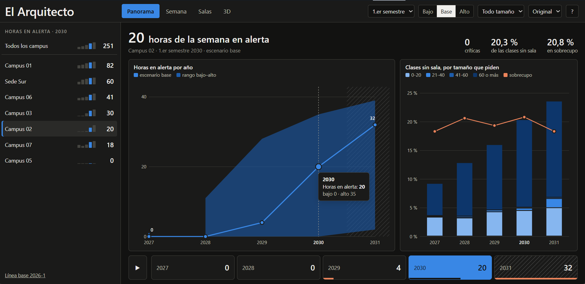
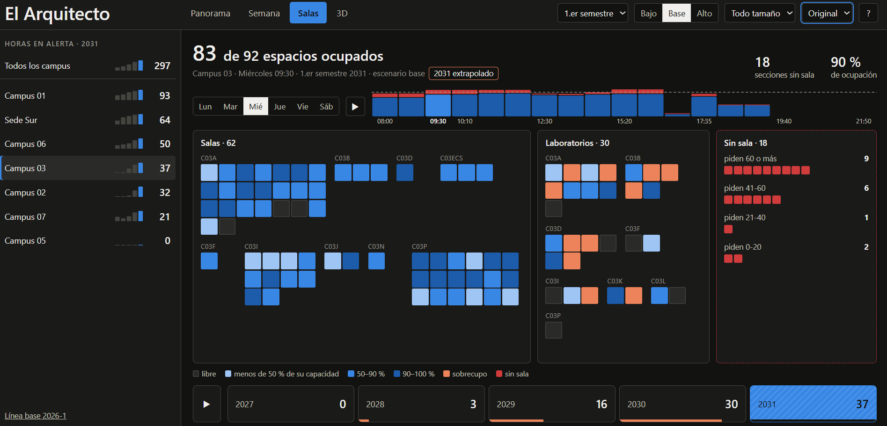
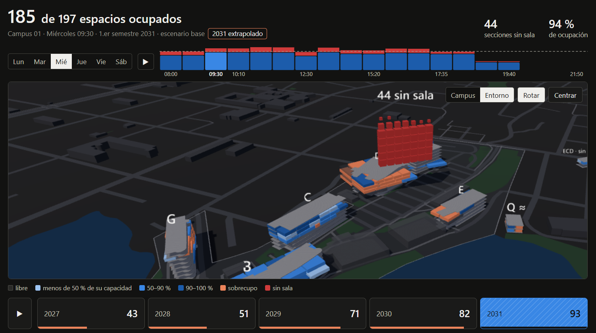
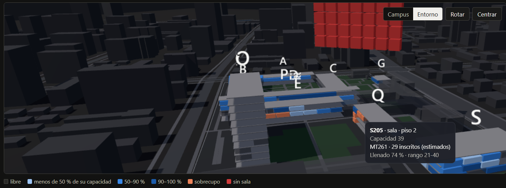
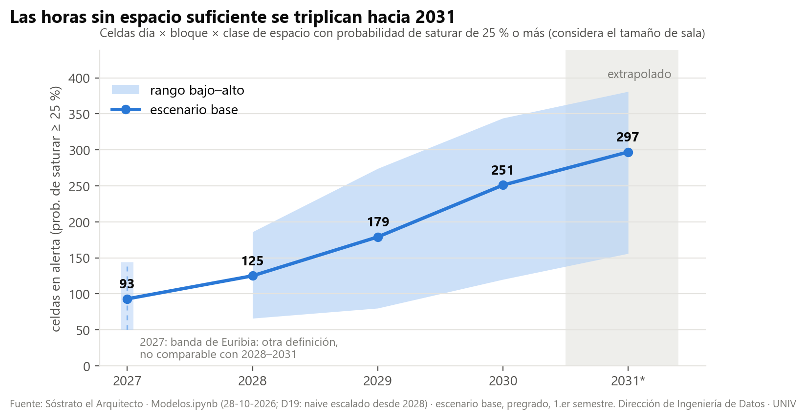

# Sóstrato el Arquitecto

**Dónde y cuándo faltarán salas y laboratorios en una universidad, 2027–2031.**
Data product de ingeniería de datos y ciencia de datos: proyecta la ocupación de la planta física, por campus, día, bloque horario, tipo y tamaño de espacio, y simula dónde dejará de caber la programación académica.

🔗 **Demo interactiva:** [huggingface.co/spaces/diegoevans2-arch/sostrato-el-arquitecto](https://huggingface.co/spaces/diegoevans2-arch/sostrato-el-arquitecto)



| Salas: ocupación sala por sala y secciones sin sala | Campus 3D: «dónde no cabe» la programación proyectada |
|---|---|
|  |  |



> **Datos anonimizados.** Es un proyecto real hecho para una universidad chilena, publicado aquí como portafolio. La institución, las sedes, los campus (`C01`…`C13`), los edificios, las materias (`MT001`…), las facultades y la infraestructura de datos están renombrados. La geometría 3D de los campus viene de OpenStreetMap, pero va rotada y reflejada y sin calles ni coordenadas. Las cifras agregadas son las del proyecto. Los datos de origen y las tablas intermedias (`BBDD/`) no se publican, así que los notebooks se muestran con sus salidas y no se pueden volver a correr tal cual.

*El nombre viene de Sóstrato de Cnido, el arquitecto del faro de Alejandría.*

---

## Herramientas y técnicas que muestra el proyecto

### Data engineering
| Qué | Cómo se hizo | Dónde verlo |
|---|---|---|
| Extracción desde el data lake | SQL sobre **AWS Athena** (Presto/Trino) contra el data lake institucional (stage), con perfiles SSO | `PIPELINES.ipynb` §0b |
| Empalme de fuentes heterogéneas | integra 3 data products con granos distintos (carrera, asignatura y NRC × sala × bloque). Controla la cobertura de llaves (99,6 %) y el delta de filas (−0,13 %) contra la fuente previa | `PIPELINES.ipynb` §1–§2, `DIAGNOSTICO_EMPALME.md` |
| Pipeline reproducible por capas | crudo → tablas intermedias en **Parquet** (PyArrow), con controles de regresión en cada etapa. Una revisión independiente reprodujo los 11 parquet idénticos | `PIPELINES.ipynb` §0–§9 |
| Modelado de datos | llaves compuestas, listas cruzadas y ligas con pesos (`PESO_LC`, `PESO_SEMANAS`, factor de compartición). Se normaliza a sesión-hora × bloque estándar | `PIPELINES.ipynb` §2b, §6–§7 |
| Reglas de negocio documentadas | decisiones numeradas D1–D19, cada una con su efecto medido | `SOSTRATO_IDEA_Y_ROADMAP.md` |
| Ingesta geoespacial | **OpenStreetMap / Overpass API** → polígonos de campus y edificios, conversión de lat/lon a metros locales, calce con la planta física | `scripts_fase1/campus_osm.py` |
| Generación de entregables | scripts que incrustan los datos en HTML autocontenidos, figuras con matplotlib y diagramas Excalidraw generados por código | `scripts_fase1/` |
| Despliegue | publicación automatizada a **Hugging Face Spaces** con `huggingface_hub` | `scripts_fase1/deploy_beta_hf.py` |

### Data science
| Qué | Técnica | Dónde verlo |
|---|---|---|
| Línea base | **naive estacional** (mismo semestre del año anterior), que es el rival a vencer | `VALIDACION_WALKFORWARD.ipynb` |
| Simulación | **Monte Carlo por bootstrap estratificado** de secciones reales, con elasticidad β calibrada | `Modelos.ipynb`, `DIAGNOSTICO_EMPALME.md` §13 |
| Optimización | asignación **voraz de mejor ajuste** de secciones a salas libres; lo que no cabe queda como déficit | `Modelos.ipynb` |
| Ensamble | **combinación de pronósticos** (Bates & Granger) con peso calibrado por nivel; naive escalado para el largo plazo | `DIAGNOSTICO_EMPALME.md` §13.3, §19 |
| Proyección jerárquica | top-down desde la proyección de matrícula hacia campus × materia × componente | `Modelos.ipynb` |
| Incertidumbre | **predicción conforme dividida** (*split conformal*), cuantiles q05–q95 y ensanche por horizonte | `DIAGNOSTICO_EMPALME.md` §16–§17 |
| Validación temporal | **backtesting walk-forward** con 10 orígenes, sin fuga de información (todo se recalcula con datos anteriores al origen) | `VALIDACION_WALKFORWARD.ipynb` |
| Métricas | WAPE, WAPE relativo al naive, sesgo, correlación, top-30, cobertura, CRPS relativo | `VALIDACION_WALKFORWARD.ipynb` |
| Detección de fugas y sesgos | una revisión independiente encontró una fuga de información y un error por compensación; se corrigieron y quedaron documentados | `DIAGNOSTICO_EMPALME.md` §13 |
| Probabilidad de saturación | demanda acumulada por rango de capacidad contra la oferta efectiva, con P10/P50/P90 por celda | `Modelos.ipynb` |

### Visualización y comunicación
**D3.js**, **three.js** (campus 3D), paleta validada para daltonismo, informe ejecutivo y técnico, documentos técnico-funcionales y diccionario de uso.

**Stack:** Python · pandas · NumPy · PyArrow · matplotlib · Jupyter · SQL / AWS Athena · Parquet · Overpass API · D3.js · three.js · Excalidraw · Hugging Face Spaces · Git

---

## El problema

La matrícula de pregrado crece y la planta física no crece al mismo ritmo. La pregunta de la dirección era concreta: **¿en qué campus, a qué hora y con qué tipo de sala se va a quedar corta la universidad, y cuándo?**

Para responderla hacía falta unir tres productos de datos que ya existían y que nunca se habían cruzado:

| Producto | Qué aporta | Grano |
|---|---|---|
| **Ariadna** | proyección de matrícula 2026–2031 | carrera × sede × período |
| **Euribia** | proyección de demanda de asignaturas y secciones (1–2 semestres) | asignatura × componente × sede × período |
| **Cirilo** | mapa de calor de ocupación real (programación histórica, sala por sala) | NRC × día × bloque × sala |

Sóstrato los une en un **mapa de calor de ocupación proyectada** con banda de incertidumbre y probabilidad de saturación por celda.

## Resultado principal (escenario base, 1.er semestre)

| Indicador | 2027 | 2029 | 2031* |
|---|---|---|---|
| Horas-espacio en alerta (≥ 25 % de prob. de no alcanzar) | **93** | 179 | **297** |
| Horas-espacio en alerta crítica (≥ 50 %) | 17 | 58 | 136 |
| Clases sin sala en la programación proyectada | **5,3 %** | 10,7 % | **17,4 %** |

\* 2031 es extrapolación. Siete de cada diez clases que quedan sin sala piden una de 60 o más asientos.



## Arquitectura


**Pipeline** ([`Notebooks + Scripts/PIPELINES.ipynb`](Notebooks%20+%20Scripts/PIPELINES.ipynb)):
1. Empalme de la programación histórica con datos frescos del data lake (Athena), con los horarios llevados al bloque estándar.
2. Unidad académica por materia (facultad o departamento).
3. Oferta de espacios: clase sala o laboratorio, capacidad y rango de tamaño, inventario activo u ocioso.
4. Plantillas horarias por NRC, ponderadas por semanas activas, listas cruzadas y un factor de compartición calibrado.
5. Perfil horario por serie, con cascada de respaldo (serie → materia → componente-campus → componente).

**Modelo** ([`Notebooks + Scripts/Modelos.ipynb`](Notebooks%20+%20Scripts/Modelos.ipynb)):
- **Volumen:** Euribia para el corto plazo (2027) y top-down con Ariadna para 2028–2031.
- **Programación sintética:** Monte Carlo por *bootstrap* estratificado de secciones reales (campus × unidad × nivel × clase × componente). Cada sección se reasigna a una sala libre equivalente con una asignación voraz de mejor ajuste; lo que no cabe se registra como déficit.
- **Combinación de pronósticos** (Bates & Granger): `C1 = w·naive + (1−w)·G1b`, con `w` calibrado por nivel. Desde 2028 se usa un **naive escalado** (C1E) por el crecimiento de salas del bootstrap.
- **Incertidumbre:** predicción conforme dividida (*split conformal*) con cuantiles por modelo × nivel × grano × clase × tramo, ensanchada por horizonte (`k_h`).
- **Saturación por tamaño:** demanda acumulada hacia arriba por rango de capacidad (0-20 · 21-40 · 41-60 · 60+) contra la oferta efectiva. Sale P10/P50/P90 y la probabilidad de saturar en cada celda.

**Validación** ([`Notebooks + Scripts/VALIDACION_WALKFORWARD.ipynb`](Notebooks%20+%20Scripts/VALIDACION_WALKFORWARD.ipynb)):
- Banco *walk-forward* con 10 orígenes (5 de pregrado deciden por mayoría) y todo recalculado con información anterior al origen.
- Métrica: **WAPE relativo al naive estacional**, que es el mapa real del mismo semestre del año anterior. Un modelo solo se adopta si le gana al naive en la mayoría de los orígenes.
- Lección honesta: el mapa de salas es **muy persistente**. El naive le ganó a casi todo, incluidos el perfil horario, el punta a punta y el hábito de sala. Recién la combinación C1 le ganó en 4 de 5 orígenes. Todo el recorrido está documentado en [`DIAGNOSTICO_EMPALME.md`](DIAGNOSTICO_EMPALME.md) §13–§19.
- Una revisión independiente reprodujo el pipeline desde cero y auditó el método; sus hallazgos están incorporados en el diagnóstico.

## Visualización

Las vistas son HTML autocontenidos (D3 + three.js), unidos en una demo con un reproductor 2027–2031:

- **A1** curva de alertas por año y escenario
- **A2** mapa semanal con semáforo (vigilancia 10 %, alerta 25 %, crítica 50 %)
- **A3** programación proyectada sala por sala (sobrecupo en naranja, sin sala en rojo)
- **A4** campus 3D «dónde no cabe»
- **M1–M4** línea base: año de quiebre, matriz de incertidumbre, *unit chart* de salas y campus 3D

Hay dos paletas (original y «arena») y una propuesta de rediseño UX/UI (`Documentación/renuevo_ui/`), que es la portada del Space.

## Estructura del repositorio

```
├── SOSTRATO_IDEA_Y_ROADMAP.md        idea, riesgos, fases y decisiones (D1–D19)
├── DIAGNOSTICO_EMPALME.md            bitácora técnica: hallazgos, validación y cambios de modelo
├── SOSTRATO_flujo_*.excalidraw      diagrama de flujo vigente (+ _preview.png)
├── Notebooks + Scripts/
│   ├── PIPELINES.ipynb               pipeline de datos (§0–§9)
│   ├── Modelos.ipynb                 proyección 2027–2031, banda y saturación
│   ├── VALIDACION_WALKFORWARD.ipynb  banco de validación
│   └── scripts_fase1/                datos de las maquetas, 3D desde OSM, figuras, diagramas
└── Documentación/
    ├── INFORME_EJECUTIVO_ALERTAS_2027_2031.md
    ├── INFORME_TECNICO_RESULTADOS_ALERTAS_2027_2031.md
    ├── Funcional/                    documentos técnico-funcionales y diccionario
    ├── figuras_alertas/              figuras de los informes
    ├── maquetas_visualizacion*/      vistas HTML autocontenidas (dos paletas)
    └── renuevo_ui/                   rediseño de la demo
```

## Autor

**Diego Evans Pérez Paz**, ingeniero de datos. Proyecto desarrollado entre octubre y noviembre de 2026. El código se publica tal como se trabajó, sin pulir para producción.
